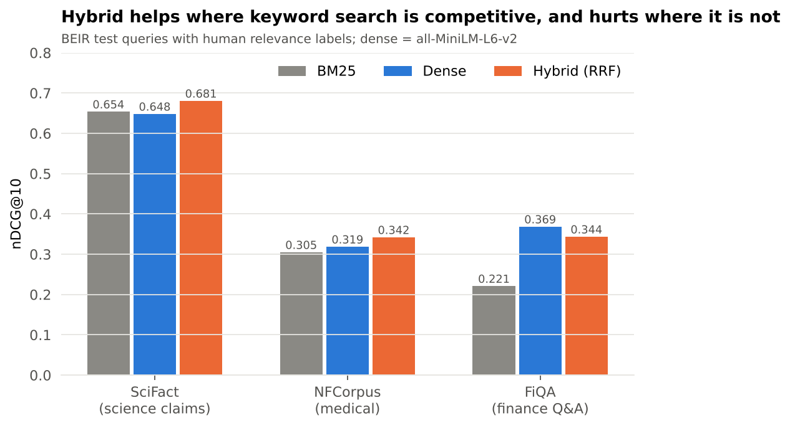

# DocIntel

A retrieval-augmented question-answering app for your own documents: upload PDFs or web pages, ask questions, get answers from Claude with citations to the page they came from.

Most of the answer quality is decided before the LLM sees anything, at retrieval. So the retrieval design here is chosen by measurement: keyword search, embeddings and their fusion are benchmarked on three public datasets with human relevance labels.

## Retrieval benchmark



| Dataset | Documents | Test queries | BM25 | Dense | Hybrid (RRF) | Hybrid vs dense, 95% CI |
|---|---|---|---|---|---|---|
| SciFact (science claims) | 5,183 | 300 | 0.654 | 0.648 | **0.681** | +0.032 [+0.006, +0.059] |
| NFCorpus (medical) | 3,633 | 323 | 0.305 | 0.319 | **0.342** | +0.024 [+0.008, +0.040] |
| FiQA (finance Q&A) | 57,638 | 648 | 0.221 | **0.369** | 0.344 | −0.025 [−0.045, −0.006] |

nDCG@10 on the [BEIR](https://github.com/beir-cellar/beir) test splits. Dense retrieval uses all-MiniLM-L6-v2; its scores match the published MTEB results for that model (SciFact 0.645, NFCorpus 0.316, FiQA 0.369). Confidence intervals come from a paired bootstrap over queries (10,000 resamples).

**Findings**

- **Hybrid search is not a free win.** Fusing keyword and embedding results with reciprocal rank fusion helps on SciFact and NFCorpus, where the two methods are about equally good and make different mistakes. On FiQA, where questions and answers rarely share words, keyword search is far weaker and drags the fused ranking down. The right setup depends on the domain and has to be measured on queries from it.
- **Recall@100 shows the same pattern** (SciFact: hybrid 0.951, dense 0.925; FiQA: hybrid 0.696, dense 0.706). Recall@100 is the ceiling for the reranking stage, which can only reorder what retrieval found.
- **Latency:** dense search takes 2 to 5 ms per query. The in-memory BM25 library scales poorly (196 ms per query on FiQA's 57,000 documents); a production deployment would use an inverted index.

Reranking with the cross-encoder is implemented but not yet benchmarked: `python benchmarks/retrieval_benchmark.py scifact nfcorpus fiqa --rerank`.

## How it works

1. **Ingest:** PDFs (PyMuPDF), URLs (BeautifulSoup) or text, split into overlapping chunks that keep their source and page number.
2. **Index:** each chunk goes into FAISS (embedding vectors, cosine similarity) and BM25 (keyword statistics).
3. **Expand:** Claude rewrites the question into three variants.
4. **Retrieve and fuse:** every variant queries both indexes; reciprocal rank fusion merges the ranked lists.
5. **Rerank:** a cross-encoder (ms-marco-MiniLM-L-6-v2) rescores the top 40 and keeps 5.
6. **Answer:** the 5 chunks and recent conversation go to Claude, which answers with numbered citations.

Answer quality is tracked with LLM-judged faithfulness, answer relevance and context precision (`src/evaluation/evaluator.py`). Failed judge calls are recorded as missing, never as a default score.

## Run it

```bash
pip install -r requirements.txt
cp .env.example .env            # add ANTHROPIC_API_KEY

uvicorn src.api.main:app --port 8000      # API: /ingest /query /evaluate /health
streamlit run app/streamlit_app.py        # chat interface
# or: docker-compose up --build
```

Benchmark (no API key needed):

```bash
pytest                                                    # 5 tests
python benchmarks/retrieval_benchmark.py scifact nfcorpus fiqa
python benchmarks/plot_results.py
```

Datasets download automatically on first use. Set `EMBEDDING_MODEL` or `RERANKER_MODEL` to a local path to use a downloaded copy of either model.

```
src/
  ingestion/     loaders, fixed and sentence-aware chunking
  retrieval/     embeddings, FAISS store, BM25, reciprocal rank fusion, cross-encoder
  generation/    Claude client, prompts, multi-query expansion, pipeline
  memory/        sliding-window conversation history
  evaluation/    LLM-judged answer metrics; BEIR loader and ranking metrics
  api/           FastAPI service
app/             Streamlit interface
benchmarks/      retrieval benchmark and chart
results/         benchmark outputs (per-query scores included)
```
